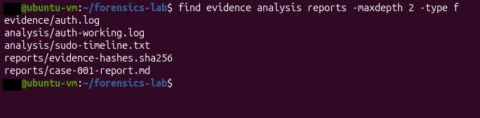
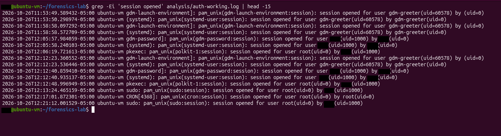
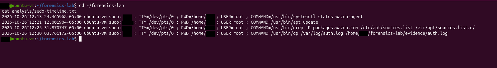
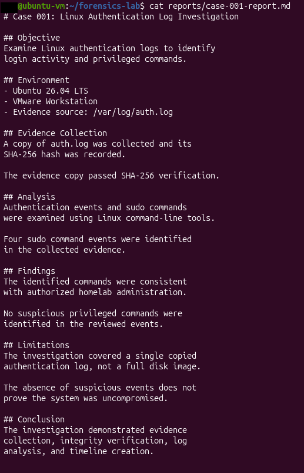
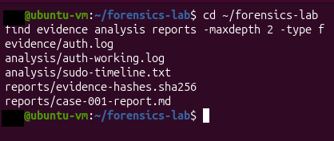
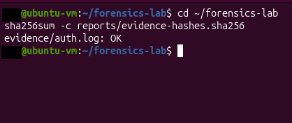

# Linux Authentication Log Forensics

A hands-on digital forensics investigation examining Linux authentication logs, privileged command execution, evidence integrity, and event timeline reconstruction.

## Project Overview

This project investigates authentication and sudo activity within an Ubuntu virtual machine. The goal was to collect log evidence, verify its integrity, analyze authentication events, reconstruct privileged command activity, and document findings.

## Lab Environment

- Operating System: Ubuntu 26.04 LTS
- Virtualization: VMware Workstation
- Evidence Source: `/var/log/auth.log`
- Tools: Linux terminal, grep, find, cat, cp, sha256sum

## Investigation Methodology

### 1. Evidence Collection
Collected a copy of the Linux authentication log for examination.

### 2. Evidence Integrity Verification
Generated and recorded a SHA-256 hash for the collected evidence. Verified the saved evidence against its recorded hash using:

```bash
sha256sum -c reports/evidence-hashes.sha256
```

The verification returned `evidence/auth.log: OK`.

### 3. Authentication Log Analysis
Reviewed authentication session events using Linux command-line tools. Examined session openings and activity involving system services, standard user accounts, and privileged accounts.

### 4. Sudo Command Timeline
Identified four sudo command events and organized them chronologically.

Observed commands included:
- Checking Wazuh agent service status
- Updating package information
- Searching APT repository configuration
- Copying the authentication log into the evidence directory

### 5. Findings
The four identified sudo commands were consistent with authorized homelab administration.

No suspicious privileged commands were identified within the reviewed events.

## Investigation Screenshots

### Lab Overview


### SHA-256 Verification


### Authentication Log Analysis


### Sudo Command Timeline


### Investigation Report


### Final Evidence Review


### Final Integrity Verification


## Limitations

This investigation examined a copied authentication log rather than a full forensic disk image. The absence of suspicious events in the reviewed evidence does not establish that the system was uncompromised.

## Skills Demonstrated

- Linux authentication log analysis
- Digital evidence collection
- SHA-256 integrity verification
- Privileged command investigation
- Event timeline reconstruction
- Forensic reporting and documentation

## Conclusion

This project demonstrates a foundational digital forensics workflow, including evidence preservation, integrity verification, authentication log analysis, sudo command review, and documented findings.

Raw authentication logs are excluded from this public repository to avoid exposing potentially sensitive system information.
